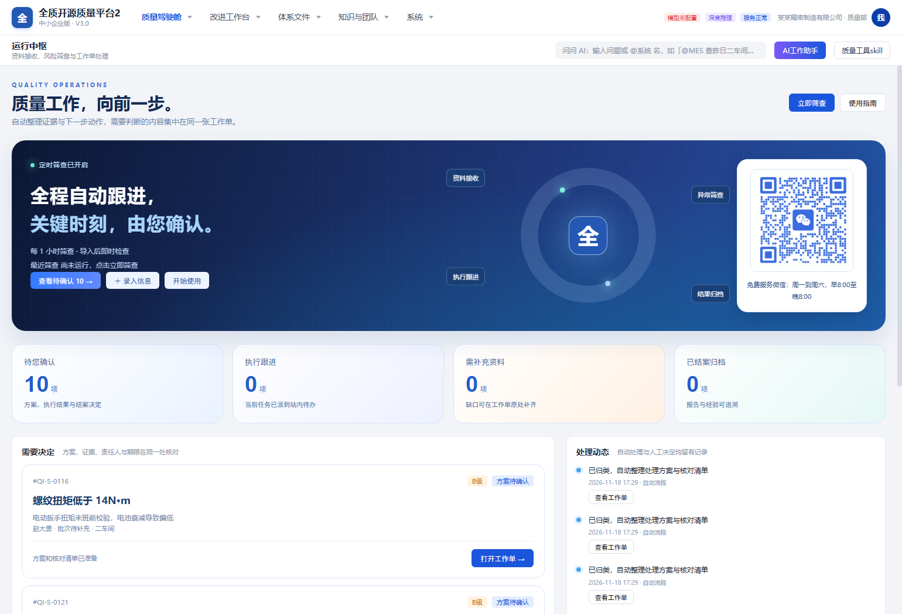
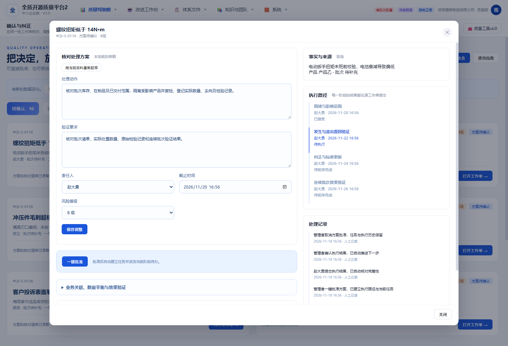

<p align="center"></p>

<h1 align="center">Total Quality</h1>

<p align="center">Free, open-source quality management for small and midsize manufacturers</p>

<p align="center">
  <a href="https://github.com/total-quality/dsh-total-quality-v3/releases/latest"></a>
  <a href="#quick-start"></a>
  <a href="LICENSE.md"></a>
  <a href="https://github.com/total-quality/dsh-total-quality-v3/stargazers"></a>
  <a href="#quick-start"></a>
</p>

<p align="center"><a href="README.md">简体中文</a> · <strong>English</strong></p>

<p align="center">
  <a href="#overview">Overview</a> · <a href="#quick-start">Quick Start</a> · <a href="#features">Features</a> · <a href="#resources">Resources</a> · <a href="#releases">Releases</a>
</p>

## Overview

Total Quality runs inside DeepSeek Harness. It is for factories that already use inspection spreadsheets, issue logs, and quality documents and want a single place for their daily quality work.

An inspection finds a batch of bushings outside the diameter tolerance. The photo goes into a group chat, the corrective action sheet into a shared folder, and the reinspection results arrive by email. At the next review, finding out who is handling the issue, how much stock was contained, and which record shows the fix worked can mean searching several places. Total Quality keeps the affected lot, measurements, owner, deadline, actions, and attachments together in one work order.



## Quick Start

1. In the DeepSeek Harness plugin manager, add `dsh-total-quality-v3.tgz` from the [release page](https://github.com/total-quality/dsh-total-quality-v3/releases/latest). Then open **全质开源质量平台2** in the sidebar.
2. Open a sample work order, approve the plan, find the assigned tasks, and submit a sample reinspection result.
3. To try your own data, use **接收与追溯** (Intake and Traceability) to import a measurement sheet. You can also record a shop-floor issue, a customer complaint, or a change request directly.

For the web profile, you can also install from a terminal:

```sh
dsh plugin --profile web add https://github.com/total-quality/dsh-total-quality-v3/releases/download/v3.0.11/dsh-total-quality-v3.tgz
```

## Features

### Quality work orders, task assignment, and closure

Import Excel, CSV, or JSON measurement records. Total Quality checks lot identifiers, specification limits, and values, then screens the data by lot and characteristic. An anomaly opens a work order with measurements and suggested next steps for the quality lead to review.

For the bushing example, the quality lead can adjust the containment scope, owners, and deadlines. Approved tasks appear in the platform's to-do list. The shop-floor team records how many parts were segregated, whether any shipped, and what the reinspection found, attaching inspection records in the same work order. The lead can request more evidence, review later lots, and close the issue when the results support closure.

Configure the screening schedule, task assignment, and archiving in settings. **The responsible person approves plans, reviews execution results, and decides when to close each work order.** Each decision records who made it, when, and their comments.



### Lot traceability and process analysis

- **Trace lots and complaints.** Record suppliers, products, lots, work steps, inspection records, and quantities in stock, in process, or shipped. Track the scope, containment, and reinspection for a complaint.
- **Monitor variation.** View I-MR, Xbar-R, Xbar-S, or EWMA control charts. Check for signals using GB/T 4091 rules and review capability metrics such as Cpk and Ppk.
- **Investigate recurring issues.** Open an improvement project and use 5 Whys to record root causes and supporting evidence. Bring existing work orders and measurements into an 8D report. PFMEA and DFMEA forms support failure chains, action priority review, and revisions.

### Company knowledge base and quality system documents

Upload your own quality manual, process specifications, or product catalogs. Ask the assistant which work instruction governs acceptance for a given operation. Follow its citations back to the source text.

You can also use existing documents to complete the quality system survey. Total Quality suggests values for applicable standards, products, processes, and quality policy based on the source. Select the values to fill in, then review and save them. Use the completed survey to draft a quality manual, procedures, and work instructions.

### Reports, lessons learned, and savings

Generate weekly, monthly, investigation, and 8D reports in Word from your operating records. Export 8D and FMEA reports in Excel or Markdown. At closure, save the investigation and effective actions for whoever handles a similar issue next. Record inputs such as annual volume and cost per defect to calculate annualized savings and payback.

## Resources

- The [installation guide](安装说明.md) covers the plugin manager and command-line installation in Chinese. The English steps are in [Quick Start](#quick-start).
- The in-app user guide covers intake, plan approval, verification, and closure.
- Work records and uploaded files are stored locally. The document library holds up to 100 MB. Document questions and form extraction send relevant excerpts to the configured Harness model. Statistics, work orders, and standard reports are available without a configured model.

## Releases

[Download the latest release](https://github.com/total-quality/dsh-total-quality-v3/releases/latest) · [Read the changelog](CHANGELOG.md) · [Report an issue](https://github.com/total-quality/dsh-total-quality-v3/issues)

Total Quality is available under the [MIT License](LICENSE.md).