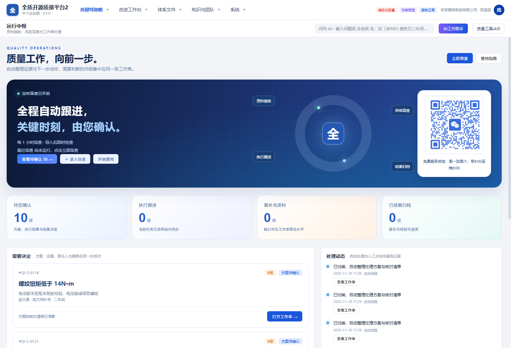
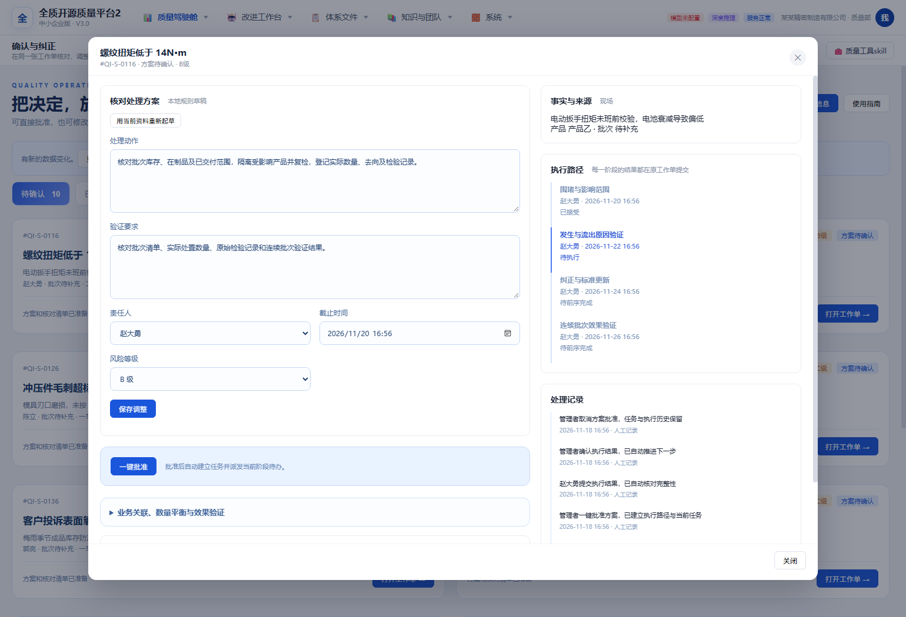

# 全质开源质量平台2

基于第三版“自主质量运营”原型实现的 DeepSeek Harness 插件。采用原生 JavaScript、Node 内置 SQLite 与现有统计 / OOXML 引擎，无 npm 运行时依赖，无前端构建步骤。

本仓库独立于 `total-quality/dsh-total-quality`，保留原插件与原数据库。侧栏显示 **全质开源质量平台2**，图标为蓝底白字的“全”字，驾驶舱右侧保留原微信服务二维码。





## 从接收到结案

1. **接收与追溯**：CSV、JSON、XLSX 先预检，核对字段、批次、规格与数值；确认后事务入库，重复文件跳过。
2. **自动筛查**：导入后和数据变化后即时检查；默认每小时定时检查。按特性 / 批次计算超规格、Cpk 和控制图判异，同一批次异常不会反复建单。结案后出现新增异常数据会建立可追溯的新工作单。
3. **方案准备**：先自动生成本地规则草稿；Harness 模型就绪时，后台整理处理动作、待验证原因与验证方式。模型结果不覆盖起草期间已经发生的人工调整，也不直接批准。
4. **集中确认**：事实、处理方案、责任人与时限在同一张工作单核对。可直接一键批准、先调整再批准，或取消批准后再次修改。取消不删除任务和历史。
5. **执行与复核**：批准后建立执行路径与站内待办。责任人填写实际结果、证据并可上传原始附件。管理者在原处接受或退回补充，系统继续下一阶段。
6. **结案与沉淀**：支持数量平衡、采购 / 生产 / 客户 / 变更追溯、连续批次验证以及标准与培训记录联动；资料未齐可保存草稿。结案后按策略生成 Word 报告和关联经验卡。

系统自动维护问题库、项目、审批记录和站内待办之间的关联。受统一流程管理的记录不能从旧页面或工具直接跳过复核。催办保存在站内；插件不会替代 ERP 冻结、出货放行或向外部人员发送通知。

## 改进工作台

支持管理问答、8D、5Why、FMEA、SPC / 过程能力、质量手册六种模式。手册模式沿用体系调研，生成后同步到体系文件。

「质量工具 skill」中的 8D 和 PFMEA／DFMEA 会打开工作台表单。8D 可关联工作单，带入现有问题、阶段记录和同批同特性测量，按 D0–D8 编排。FMEA 按七步组织，支持多条失效链、S/O/D、RPN、参考 AP 和实施后复评。参考 AP 须由团队对照企业采用的评价表核定。

这两项使用本地处理，可预览章节、下载 Word／Excel／Markdown，并在同一条分析记录上修订。工具菜单另外保留单项评分、统计计算和问答引导；问答引导填入输入框，由用户编辑并发送。

模型通过现有 Harness LLM 桥接调用。模型未配置或返回不可用内容时，明确显示本地资料整理及错误提示；不把工具协议 JSON 当成回答，不虚构检测、执行或批准结果。SPC / Cpk 沿用既有统计引擎，测量点数不作为产品不良件数。

## 用户知识库文件

从「知识与团队 → 知识库文件」上传企业手册、产品目录和工序规范。文件库默认空白，原有演示经验卡在独立的经验传承页面。上传支持 TXT、Markdown、CSV、DOCX、XLSX。文件库总容量为 100 MB。若系统 PATH 有 Poppler 的 `pdftotext`，也可上传有文字层的 PDF。

参考 [WeKnora 文档入库](https://github.com/Tencent/WeKnora/blob/main/website-docs/02-architecture/03-document-pipeline.md) 与 [检索流程](https://github.com/Tencent/WeKnora/blob/main/website-docs/02-architecture/04-rag-pipeline.md)，文件先持久化并进入队列，后台解析、重叠分块、建立父段与检索片段映射并原子写入索引。解析可重试，重启会接续未完成入库。助手改写问题，融合原句和改写句的 BM25 召回，模型重排后回读父段补足语境，同一父段去重后生成带引用的回答。

- 在 AI 工作助手勾选「查知识库」，或从文件页点击「在助手里查」。引用可打开片段并下载原文件。
- 在企业设置或体系调研点击「从知识库带入」。候选值带引用，只填所选字段，提交仍走原表单。公司名称由企业设置统一维护。
- 默认使用本地 SQLite FTS5。可在启动 Harness 时设置 `QIP_KB_EMBED_MODEL` 为已在本机 Ollama 加载的嵌入模型名称，启用向量召回与 RRF 融合。向量服务不可用时关键词索引仍可用。回答和提取始终使用 Harness 的模型配置。
- 原文件和索引保存在业务数据目录的 `knowledge-library-sme.db`。进入知识库文件页面可单独重建索引或移除文件。业务样例重建不会清掉用户上传文件。选择问答或提取时，相关片段会交给 Harness 所选模型。

## 体系调研

进入「体系文件 → 填写体系调研」。可先保存草稿，之后按模块继续填写。公司、适用体系和覆盖产品保存后即可生成文档草稿。手册沿用调研中的流程、职责、质量目标与签署信息。公司、部门、产品和车间从「企业设置」维护。

## 安装

在 DeepSeek Harness 的插件管理器中添加本仓库的 Release 包，或在已安装 DSH 与 pnpm 的终端执行：

```sh
dsh plugin --profile web add https://github.com/total-quality/dsh-total-quality-v3/releases/download/v3.0.9/dsh-total-quality-v3.tgz
```

安装到当前使用的 profile 后，按宿主提示加载，点击侧栏“全质开源质量平台2”。无需再启动占用同一端口的 DSH 进程。Desktop 用户应安装到其实际使用的 profile。

## 独立命名与数据

| 项目 | 本版 |
| --- | --- |
| 包名 | dsh-total-quality-v3 |
| 宿主 / 侧栏标识 | qip-real-v3 |
| 页面 | /qip-real-v3/ |
| 宿主工具前缀 | qip_real_v3_ |
| 默认数据 | ~/.dsh/qip-real-v3/data/ |
| 自定义数据目录 | QIP_REAL_V3_DATA_DIR |
| 品牌缓存 | qip-real-v3.brand |

首次运行保留原合成样例：48 条问题、5 个项目、600 个测量点、16 条知识、12 名成员。运营工作单及关联审批 / 留痕在样例上新增，不删除原样例。数据、报告和附件保存在本机，不随代码推送到 GitHub。

真实使用前备份整个数据目录，再通过系统的“清空业务数据”清除样例并导入资料；清空状态在重启后保留。“重建初始数据”恢复中小企业样例。不要将本版与旧插件设置为同一个可写数据目录。

## 校验

```sh
node 自检.cjs
node scripts/check.cjs
node --test
```

检查涵盖流程状态、重复导入、复发、并发版本、数量核对、保存回滚、模型草稿冲突、附件范围、SQLite 重载及二维码原图校验。浏览器验收另覆盖页面、指南、批准、提交与复核、取消批准、文件预检接收、分析留档和窄屏显示。

所有页面主要操作区提供使用指南。源代码与版权声明按 MIT 保留，见 [LICENSE.md](LICENSE.md)。
